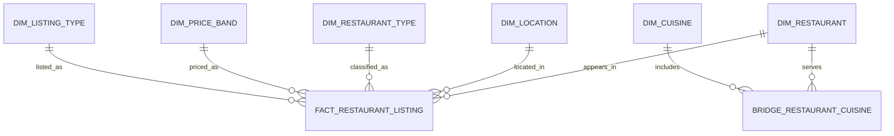

# Analytics Data Model

## Purpose

This model supports restaurant market analysis and expansion screening. It separates a restaurant's stable attributes from its listing-category appearances and expands multi-value cuisines safely.

## Tables

| Table | Grain | Key fields | Why it exists |
| --- | --- | --- | --- |
| `dim_restaurant` | One canonical restaurant URL | `restaurant_key` | Supports distinct restaurant counts and ML grouping |
| `dim_location` | One normalized locality | `location_key` | Enables locality comparisons |
| `dim_restaurant_type` | One normalized restaurant type | `restaurant_type_key` | Supports type segmentation |
| `dim_price_band` | One price band | `price_band_key` | Keeps price definitions consistent in Power BI |
| `dim_listing_type` | One listing category | `listing_type_key` | Preserves source listing context |
| `dim_cuisine` | One cuisine | `cuisine_key` | Supports cuisine analysis |
| `bridge_restaurant_cuisine` | One restaurant-cuisine combination | `restaurant_key`, `cuisine_key` | Resolves the many-to-many cuisine relationship |
| `fact_restaurant_listing` | One canonical restaurant and listing type | foreign keys plus observed measures | Carries rating, votes, cost, and service availability |
| `mart_market_opportunity` | One locality-cuisine-price band | locality, cuisine, price band | Feeds Power BI expansion screening |

## Counting Rules

- **Restaurant Count:** distinct `restaurant_key`.
- **Cuisine Restaurant Count:** distinct `restaurant_key` through the cuisine bridge.
- **Average Rating:** average valid `rate_clean`; always expose a minimum-vote eligibility rule for high-rated metrics.
- **Engagement:** sum or average votes, labelled as an engagement proxy.

## Power BI Relationships

Use one-directional relationships from dimensions to `fact_restaurant_listing`. Connect `dim_cuisine` to the fact through `bridge_restaurant_cuisine`; do not join comma-separated cuisine text directly to the fact table.
